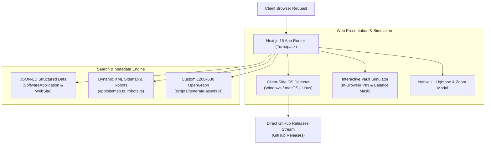

# Acctx Web 🌐

> **The Official Landing Page, Web Portal & Distribution Hub for Acctx Desktop**

<p align="center">
  
</p>

<p align="center">
  <a href="https://github.com/RishiBose961/Acctx-Web/releases"></a>
  <a href="https://nextjs.org"></a>
  <a href="https://react.dev"></a>
  <a href="https://tailwindcss.com"></a>
  <a href="https://bun.sh"></a>
  <a href="LICENSE"></a>
</p>

---

## 🎯 About This Repository

While the core [**Acctx Desktop App**](https://github.com/RishiBose961/Acctx) handles local financial bookkeeping, encrypted storage, and desktop OS integration, **Acctx-Web** is the public face and distribution engine of the project.

This codebase contains the complete source for the official marketing website, client-side release router, interactive in-browser simulation, and search-engine optimization (SEO) architecture designed to introduce users to offline personal finance.

---

## 💎 Design Philosophy: High-Craft Web Experience

Acctx-Web was engineered from the ground up to break away from generic SaaS marketing templates, drawing heavy inspiration from the design standards of **Linear**, **Raycast**, and **Vercel**:

- **Obsidian Dark Mode & Glassmorphism**: Tailored color palette centered around deep slate (`#090a0f`) with layered backdrop blur panels (`backdrop-blur-xl`) and hairline `1px` translucent borders (`border-white/8`).
- **Ambient Lighting Mesh**: Radial gradients and blurred glowing emitters strategically positioned to create depth behind the hero headline and download call-to-actions.
- **Asymmetric Bento Grids**: Modular card hierarchies that highlight technical capabilities without cognitive overload.
- **Micro-Interactions**: Smooth hover elevations, button ping indicators, spring transitions, and interactive OS selectors.

---

## ⚙️ Web Architecture & Technical Highlights



### 1. Intelligent OS-Aware Release Router
The download engine inspects the client environment (`navigator.userAgent`) and dynamically adjusts the primary CTA button:
- **Windows Users**: Directly serves the 102 MB `Acctx-Windows-Setup.exe` installer with one-click download telemetry.
- **macOS & Linux Users**: Automatically presents clear development roadmap tags ("Coming Soon") alongside fallback dropdown selectors so users can manually inspect any build format.

### 2. In-Browser Interactive Simulation
Rather than relying solely on static images, the website incorporates an interactive playground (`InteractivePreview.tsx`):
- Lets visitors click on an authentic 6-digit PIN pad to preview the lockout interface before downloading.
- Demonstrates balance privacy masking and recurring bill cycle advancement in pure client-side React.

### 3. SEO & Rich Snippets Optimization
Constructed according to Google Search Central guidelines:
- **Schema.org Structured Data**: Validated `SoftwareApplication` and `WebSite` JSON-LD embedded directly to ensure Google displays rich snippets, software category flags, and direct download buttons in search results.
- **Indexable Sitemap**: Clean XML sitemap devoid of fragment hash anchors (`/#...`), preventing crawl budget waste.
- **Custom OpenGraph Engine**: Includes a headless asset generator (`scripts/generate-assets.js`) to produce crisp 1200×630px social preview cards (`og-image.png`) with branded typography and metadata tags.

---

## 🧩 Component Architecture

The frontend is structured into modular, reusable components inside `components/`:

| Component | Role on the Website |
| :--- | :--- |
| **`Navbar.tsx`** | Responsive glass navigation bar with brand badge, mobile drawer, and GitHub repo counter. |
| **`Hero.tsx`** | Top fold containing the dynamic OS downloader, live version pill, and primary value proposition. |
| **`InteractivePreview.tsx`** | Simulated desktop client replicating PIN entry, cash flow cards, and bill cycles. |
| **`Features.tsx`** | Asymmetric Bento grid detailing local offline storage, smart bills, and zero-telemetry promises. |
| **`DesktopGallery.tsx`** | Unretouched desktop app captures with categorized tabs and full-screen lightbox zoom. |
| **`SecurityShowcase.tsx`** | Interactive security diagram illustrating local salted key derivation and authenticated ciphers. |
| **`Comparison.tsx`** | Side-by-side feature matrix evaluating Acctx vs. Cloud Apps (YNAB/Rocket Money) vs. Legacy software (GnuCash). |
| **`DownloadSection.tsx`** | Complete download platform matrix displaying platform specs, checksum notices, and direct binary URLs. |
| **`FAQSection.tsx`** | Accordion covering common user inquiries regarding privacy, data migration, and OS availability. |
| **`Footer.tsx`** | Clean footer featuring project attribution, release links, and open-source licensing details. |

---

## 🛠️ Technology Stack

| Category | Technology | Purpose |
| :--- | :--- | :--- |
| **Framework** | **Next.js 16.4** | Modern React App Router with Turbopack for sub-second hot reload |
| **Library** | **React 19.3** | UI component rendering with latest React performance primitives |
| **Styling** | **Tailwind CSS v4** | Modern CSS-first design system with native Turbopack compilation |
| **Language** | **TypeScript 5.x** | Strict end-to-end type safety |
| **Package Manager** | **Bun / npm** | High-speed dependency management and local execution |
| **Asset Generation** | **Node.js Script** | Programmatic SVG-to-PNG social asset rasterizer |

---

## 💻 Local Development

### 1. Clone & Install
```bash
# Clone this repository
git clone https://github.com/RishiBose961/Acctx-Web.git
cd Acctx-Web

# Install dependencies using Bun or npm
bun install
# or
npm install
```

### 2. Start the Dev Server
```bash
bun dev
# or
npm run dev
```
Open **[http://localhost:3000](http://localhost:3000)** in your browser. Turbopack will compile the pages in under 400ms.

### 3. Production Build & Quality Checks
```bash
# Check TypeScript types and compile static production output
npm run build

# Run ESLint validation
npm run lint

# Regenerate social share assets (og-image.png, touch icons)
npm run generate:assets
```

---

## 🌐 Distribution & Download Link Mapping

All landing page download CTAs link to the official binaries released on GitHub:

- **Official Releases**: [`https://github.com/RishiBose961/Acctx-Web/releases`](https://github.com/RishiBose961/Acctx-Web/releases)
- **Windows Setup**: Available under the latest release assets (.exe)
- **Repository Integration**: Connects directly to issues, discussions, and release telemetry.

---

## 👥 Contributors & Credits

<p align="left">
  <strong>Concept & Core Product</strong>: <a href="https://github.com/RishiBose961">Rishi Bose</a>
  <br />
  <strong>Web Design, Frontend Architecture & SEO</strong>: <a href="https://github.com/RishiBose961">Rishi Bose</a> & <a href="https://github.com/ayanbanerjee-png">Ayan Banerjee</a>
</p>

---

## 📄 License

This website is open-source software licensed under the **[MIT License](LICENSE)**.
